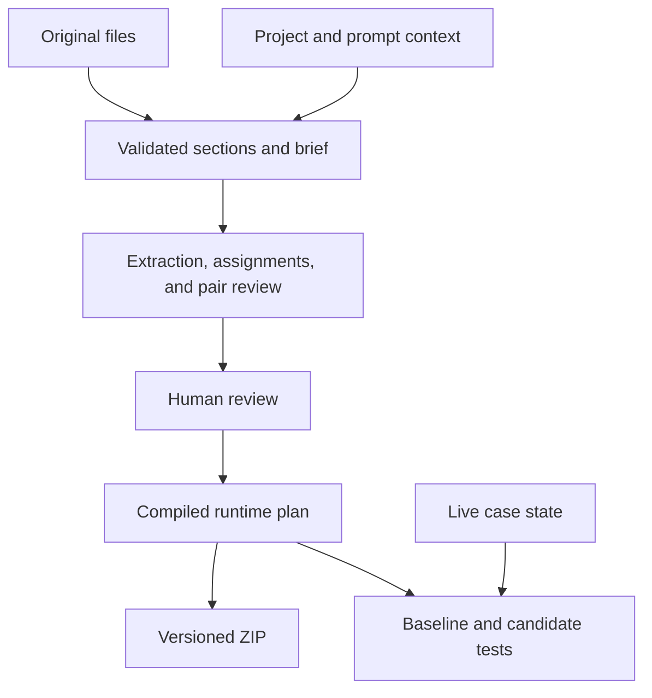

# Backend algorithm integration

This proposal describes the backend semantic pipeline and the later wiring into the existing Promptimize workbench. The current workbench sends only `{files}`. That keeps the legacy path by default. For owner review, a Preview deployment can opt into the semantic backend through the server-only `PROMPTIMIZE_PREVIEW_ALGORITHM=semantic-v1` setting; it is ignored outside `VERCEL_ENV=preview` and is scoped to the backend branch in Vercel. An explicit `algorithm: "legacy"` keeps the historical path even in that preview. An API caller can select `algorithm: "semantic-v1"` and supply versioned project and prompt context alongside the files.

## From source to test



1. Validate source files and optional context. Keep stable project facts, per-component information, and live execution state separate.
2. Segment source structure and validate every extracted quote against the original. Source locations use zero-based UTF-16 offsets, with an exclusive end and one-based line numbers. The HTTP endpoint accepts 1–12 files with 50,000 source characters in total. Retain source regions the extraction cannot account for.
   Markdown and text segmentation recognizes headings, fenced blocks, lists, and named intent definitions. Python uses an isolated standard-library AST parser when available. JSON receives syntax validation. Unsupported code or parser failures retain the original text and surface a diagnostic. Uploaded scripts are treated as source data.
3. Extract rule boundaries and workflow assignments in bounded Muse Spark Standard calls. Compare shortlisted pairs in a separate, smaller stage. Exact matches can share storage when provenance and applicable scope are retained.
4. Record overlapping, conflicting, or potentially equivalent rules with evidence. Keep semantic removals pending until an explicit review request. Preserve original source even when candidate text is edited or an approved consolidation takes effect.
5. Compile stable module IDs, editable output paths, the source map, and runtime selection metadata deterministically. Use the compiled candidate for tests and export.

## Context contract

The three inputs describe different scopes. `projectContext` holds stable facts about the application and its policy. Each `promptContext` entry identifies a file in the same request and describes its caller, scope, or intended behavior. Live state belongs to a case or runtime request. For example, `projectContext.stateFields: ["deskPhase"]` describes a field the application uses, while a live case may provide `deskPhase: "roster-collection"`.

The following request uses a fictional observatory.

```json
{
  "algorithm": "semantic-v1",
  "files": [
    {
      "name": "station/target-console.md",
      "content": "# Shift roster\n- During roster collection, resolve names as duty technicians."
    }
  ],
  "projectContext": {
    "schemaVersion": 1,
    "projectId": "fictional-kestrel-observatory",
    "version": "night-shift-1",
    "status": "approved",
    "purpose": "Route requests for a fictional observatory night shift.",
    "actors": ["operator", "duty technician"],
    "glossary": [
      {"term": "roster", "meaning": "The duty technician roster", "authority": "user-approved"}
    ],
    "stateFields": ["deskPhase"],
    "invariants": [
      {"id": "roster-scope", "text": "Roster collection applies to technicians.", "authority": "user-approved"}
    ],
    "workflowHints": ["shift-staffing"],
    "references": [
      {"id": "shift-handbook", "title": "Shift handbook", "text": "Night operators manage the duty roster.", "authority": "user-approved"}
    ]
  },
  "promptContext": [
    {
      "sourceFile": "station/target-console.md",
      "purpose": "Resolve a name using the active desk phase.",
      "caller": "assemble_observatory",
      "supportedIntents": ["select_technician"],
      "authority": "user-approved"
    }
  ]
}
```

| Scope | Accepted fields |
| --- | --- |
| Project identity | A supplied object requires integer `schemaVersion: 1`, strings `projectId` and `version`, and a `status` of `approved` or `draft`. Optional `authority` and `purpose`. |
| Project catalog | Optional string arrays `actors`, `stateFields`, `workflowHints`, `tools`, and `outputs`. |
| Project evidence | Optional `glossary` accepts `[{term, meaning, authority?}]`. The `invariants`, `exceptions`, and `examples` lists each accept `[{id, text, authority?}]`. The `references` list accepts `[{id, title, text, authority?}]`. |
| Prompt identity | Each entry requires an exact `sourceFile` from `files`. Optional `component` distinguishes multiple entries for the same file. The file/component pair must be unique. Optional `schemaVersion` and `version` default to `1` and `"1"`. |
| Prompt metadata | Optional strings `purpose`, `scope`, `caller`, and `authority`. Optional string arrays `callers`, `supportedIntents`, `dependencies`, `knownBugs`, `knownExceptions`, and `expectedBehavior`. |

Authority values are `user-approved`, `source-observed`, and `inferred`. Project authority defaults to `user-approved` for an approved project and `inferred` for a draft. Project evidence can declare its own authority or inherit the project default. Prompt authority defaults to `inferred`. Text fields require nonempty strings. Most strings have a 500 UTF-16 code-unit cap. IDs and versions are capped at 100, source names and reference titles at 200, component labels at 150, purpose and structured fact text at 1,500, and reference text at 5,000. The normalized context is capped at 40,000 UTF-8 bytes, with at most 48 prompt records and at most 32 items in the other lists.

Only an approved project can contribute to the 2,400-byte compact brief. Only user-approved facts are eligible for that brief. Repeated glossary terms or evidence IDs with different claims create pending context conflicts, and conflicting claims stay outside the brief. The optimizer selects up to four prompt records for the files in an extraction batch and up to two lexically related approved references, excerpted to 500 code units each. A runtime predicate must match state names and values in the source or approved context to influence routing. Ungrounded predicates leave the original rule available in shared context and create a review item. Approval does not authorize a conflict to supersede the original source.

To exercise missing context, submit the same `files` and `algorithm` while omitting both context fields. The backend records a draft and can emit source-linked purpose hints from original text in `analysis.semantic.inferredContext`. Treat those conclusions as provisional until the owner confirms them. For consequential rules, review must resolve missing policy authority, ambiguous actors or state, and source conflicts before relying on a narrower candidate.

The normalized context has a SHA-256 fingerprint exposed as `analysis.semantic.contextFingerprint`. It is computed over canonical JSON of the versioned project and prompt inputs. The proposal's `analysis.sha256` identifies the candidate. It covers source files, rules, assignments and relations, output paths, case definitions, context and algorithm versions, and review decisions. Call receipts and review timestamps sit outside that hash. Historical analyses use their original snapshot format. Use a new context version when changing an approved fact and analyze again.

## Shortlisting and model budget

The shortlist uses a local inverted index with BM25 scoring over original rule text, headings, intent names, and validated state fields. Exact underscore-delimited identifiers boost the rank. Pairs compete for a bounded shortlist, including pairs with similar wording and distinct actors or conditions. Such pairs can expose exceptions or conflicts. The model receives only shortlisted pairs for comparison. An omitted pair remains unreviewed.

The optimizer uses Standard `muse-spark-1.3` at low reasoning effort for extraction and medium effort for scoped pair comparison. Execution benchmarking uses identical model settings for both sides. Stage records distinguish fresh calls, cache hits, provider-reported usage, and incomplete work. Reserved tokens are an estimate, while provider-reported usage is evidence from actual calls.

| Limit | Default |
| --- | --- |
| Source per extraction batch | Up to 8,000 UTF-16 code units or 28 sections, with neighboring excerpts for interpretation |
| Extraction completion cap | 3,800 tokens per call, up to 32 proposed rules per batch |
| Candidate pairs | Up to three neighbors per extracted rule and 24 distinct pairs overall |
| Comparison batch | Up to six pairs and 16,000 combined quote code units, with 3,000 completion tokens per call |
| Refactor budget | Up to 10 provider attempts and 80,000 reserved tokens across both stages |

The reservation estimates input as the ceiling of serialized UTF-8 request bytes divided by three, plus 32 tokens. It adds the full completion cap, including possible reasoning. At most three extraction calls or two comparison calls run concurrently. When a stage reaches a limit or produces incomplete output, the backend records it and retains the unverified source. There are no automatic provider retries.

Stage reuse is opt-in through a trusted server-side `cacheScope`. The key hashes that scope, context, the model and stage settings, the algorithm and prompt versions, and the complete stage messages. Extraction keys use the project context and the prompt contexts relevant to that batch. Comparison keys use the full normalized context fingerprint. The stage messages carry the source text used for that call. The default store retains up to 32 entries in memory per process. The public endpoint has no authenticated project scope and uses uncached analysis.

## Retrieval and compiled execution

The runtime seeds the compact context from shared rules, matching workflow or intent metadata, matching state predicates, and explicit required rule IDs. It can supplement those seeds with lexical matches from rule text and canonical intent names. Rule and relation conditions use `{field, op, value?}` and can read dotted keys from the live state. Operators are `eq`, `neq`, `present`, and `absent`. A missing field required by a comparison is tracked as unresolved.

Closure includes required companions and both ends of an applicable override. Proposed edges can conservatively add source material while they await approval. The runtime uses the original instructions to express override behavior and co-loads graph cycles without looping. It reports the cycle members for review.

When there is no narrow match or the selection exposes missing state, dependencies, required phase evidence, or a relevant conflict, the runtime can expand once to all retained rules and approved references. The expansion is local and happens before provider generation. If the selection is still missing a requirement or exceeds 50,000 UTF-16 code units, it returns an unresolved result with reason codes. In particular, missing phase state calls for clarification before relying on any associated action. Both semantic test routes size the exact request and enforce a per-call limit of 20,000 tokens, including a 750-token completion reserve. They use Standard Muse Spark with minimal reasoning for both baseline and candidate.

A reported source conflict suppresses the compiled project brief and approved references. An affected context conflict or a contradiction between selected rules produces an unresolved selection. Review the conflicting evidence before generating a case answer.

The compiled plan preserves stable rule order, deduplicates by rule ID, and applies approved consolidation aliases. The manifest keeps `format: "promptimize.v2"` and adds `semantic: {algorithm, schemaVersion, runtime}`. Its `runtime` points to `runtime.json`, which contains the snapshot and `runtimeVersion: 1`. The Python loader uses the plan for routing metadata, then reads exact instruction text from the actual module Markdown files. Exported runtime metadata contains module SHA-256 hashes instead of a second embedded text copy. It rejects edited, missing or inconsistent module files before generation. Corrections must go through Promptimize Review and a new frozen export. The Python runner reproduces the Node selection and request. The source map retains the original rule records and their evidence. The exported runner returns model decisions. The built-in server cases add deterministic simulation to their results.

## Endpoints and frozen proposals

| Endpoint | Semantic request | Compatibility |
| --- | --- | --- |
| `POST /api/analyze` | `{files, algorithm: "semantic-v1", projectContext?, promptContext?}` | `{files}` keeps the existing analysis path. The semantic response still supplies `rules`, `modules`, `paths`, `sha256`, `model`, and `usage`. |
| `POST /api/review` | `{files, analysis, draft}`. Semantic approval fields belong inside `draft` | Existing `paths`, `assignments`, `text`, and `notes` keep their roles. |
| `POST /api/package-check` | `{files, analysis}` | Static validation checks the generated bundle for the given snapshot. |
| `POST /api/export` | `{files, analysis, results}` | Returns a ZIP. Semantic exports add runtime version metadata and `runtime.json` alongside the v2 manifest. |
| `POST /api/preflight` | `{files, analysis}` | Sizes the built-in JD and event suites. Adds `unresolvedCases` for semantic proposals and sets `canRun: false` when a case is unresolved, the reserve exceeds the suite limit, or the candidate does not reduce initial input. |
| `POST /api/classify-case` | `{files, analysis, test: {id}, mode}` | Uses the known JD case's state and utterance. Returns the existing classification and deterministic dispatch trace. |
| `POST /api/run-case` | `{files, analysis, test, mode}` | Uses the bundled event case contract and preserves the bounded simulated lookup. |

Test `mode` is `baseline` or `candidate`. An unresolved semantic case returns HTTP 200 with `status: "incomplete"`, `pass: null`, a reason, usage so far, the snapshot, and `contextSelection` when available. A selection receipt includes the tier, selected rule IDs and modules, fallback reasons, unresolved requirements, cycle members, and character count. The built-in test routes use their own suites. For a custom bundle, build a request with `semanticCase` in Node or use the exported Python runner. The runner accepts `--context` for a JSON state file, `--utterance`, optional `--intent` and repeatable `--require-rule`. Known fixtures can use `--case`. Use `--dry-run` to inspect selection and request messages without contacting Meta. A future workbench can add a reviewed custom case contract.

The analysis response keeps the original fields and adds the following records. Fields marked `?` are optional.

| Record | Fields |
| --- | --- |
| Rule | `{id, file, line, quote, sources, workflows, intents, actor, scope, action, exceptions, conditions, sourceStatus, candidateText?}`. `sourceStatus` is `extracted` or `retained`. |
| Source span | `{id, file, line, endLine, start, end, sha256}`. The hash is SHA-256 of the exact span in UTF-8. A source ID can appear in several records. |
| Assignment | `{ruleId, workflow, subworkflow, conditions, evidence, rationale, status, moduleId?}`. `status` is `proposed` or `unresolved`. `moduleId` is present for mapped proposals. |
| Relation | `{id, type, from, to, conditions, evidence, rationale, status}`. `type` is `requires`, `overrides`, or `applies_when`. `status` is `proposed` or `approved`. |
| Pair assessment | `{id, left, right, kind, sameScope, evidence, rationale}`. `kind` is `equivalent`, `overlap`, `contradiction`, `exception`, `override`, or `unrelated`. |
| Removal proposal | `{id, keepRuleId, removeRuleId, conditions, evidence, rationale, tests, retention, status}`. Retention lists `workflowAssignments` and `relationIds`. `status` is `pending` or `approved`. |

Rule, assignment, comparison, relation, and removal evidence arrays point to source spans. Inferred hints point to the corresponding `sourceWindows` entry and carry `authority: "inferred"`. A removal proposal's `tests` are suggested checks for the reviewer. Use separately authored test results when deciding whether a proposal preserves behavior. The wrapper `analysis.semantic` includes `schemaVersion: 1`, `algorithm: "semantic-v1"`, the prompt version, context fingerprint, compact brief, eligible references, a draft when project context is absent, source-linked inferred hints, context conflicts, parser diagnostics, source windows, comparisons, assignments, relations, pending actions, review items, and call receipts. Its field names are `promptVersion`, `contextFingerprint`, `brief`, `references`, `contextDraft`, `inferredContext`, `contextConflicts`, `diagnostics`, `sourceWindows`, `comparisons`, `assignments`, `relations`, `removalProposals`, `reviewItems`, and `calls`.

The review fragment below illustrates `draft`. Send it alongside the original `files` and current `analysis`. Read the actual IDs from the current proposal and submit only the IDs explicitly selected by the reviewer.

```json
{
  "draft": {
    "notes": "Reviewed the evidence and the case covering the rule's scope.",
    "approvedRemovalIds": ["<pending removal ID>"],
    "approvedRelationIds": ["<proposed relation ID>"]
  }
}
```

These approvals accumulate within a proposal chain. An approved same-scope equivalence aliases the removed rule to its canonical survivor for runtime and export. The original rule and source spans remain in the audit and source map. Compare a reviewed proposal by its new `analysis.sha256`, and keep the previous snapshot and results available as separate records. Folder path edits use `draft.paths` and preserve the internal routing IDs. Competing or chained consolidations, unknown or repeated approval IDs, and consolidation of candidate-edited text require a fresh review or analysis.

## Proposed workbench wiring

| Existing step | Later integration | Backend field or action |
| --- | --- | --- |
| Input | Keep source uploads and add optional project facts, context version, authority, and per-file context | `files`, `projectContext`, `promptContext` |
| Input | Explicitly select the new algorithm once the release criteria pass | `algorithm: "semantic-v1"` on `POST /api/analyze` |
| Audit | Show evidence for proposed placement and flag inferred or conflicting facts | `analysis.semantic.assignments`, `analysis.semantic.reviewItems` |
| Proposal | Show the stable module ID separately from the editable folder path | `analysis.modules`, `analysis.paths`, `draft.paths` |
| Review | Show affected rules, source evidence, conditions, dependencies, and test evidence before requesting consolidation | `analysis.semantic.removalProposals`, `analysis.semantic.relations` |
| Candidate and Tests | Bind preparation, export, preflight, and results to the frozen candidate hash | `analysis.sha256`, existing `files` and `analysis` payloads |

Suggested input field names mirror the contract. Use `projectContext.purpose` for a short description, `actors` and `glossary` for roles and terminology, `workflowHints` for recognizable workflows, and `stateFields` for names of state properties. Record always-applicable constraints in `invariants` and keep supporting documentation in `references`. For each uploaded component, use `promptContext.sourceFile` as the exact file key and collect the purpose, caller, scope, and known behavior against that key.

Ask the reviewer to confirm project facts before assigning approved status. Treat source-observed and inferred statements as interpretation evidence and show their authority in review. A future prose-to-brief form can propose draft fields from a note or attachment, then ask the user to confirm them before submitting a new approved version. A separate human decision is required to change intended behavior. Keep current session state in the test or request state instead of adding it to the stable project brief.

If a source or context fact changes, send a new analyze request and carry any relevant decisions into a new review. Keep prior analyses and their test evidence keyed by snapshot. Clear the current proposal's preflight and package-check result when a new snapshot supersedes it.

## Reproduce the integration

Run these commands from the repository root.

```bash
node tests/backend/semantic-cli.cjs
node tests/backend/semantic-cli.cjs --with-context
node --test tests/backend/*.test.cjs
```

The CLI examples use a deterministic provider double. The synthetic [request fixture](../../tests/backend/fixtures/observatory.json) and [case oracle](../../tests/backend/fixtures/observatory-cases.json) provide worked examples. Use the `--live` mode only with an approved fixture and a server-side provider credential. Keep the credential out of request JSON and export bundles.

For the selected UIC files, prepare a private request JSON with the three files from the handoff. The evaluator prints aggregate metrics and compares source-only semantic analysis with the existing heuristic. If the request also contains reviewed context, it adds a context-informed arm. Reviewed employer context has yet to be supplied.

```bash
node tests/backend/evaluate-uic.cjs --request /private/path/uic-request.json --structural
node tests/backend/evaluate-uic.cjs --request /private/path/uic-request.json --live --warm
```

The structural command makes zero provider calls. The live command requires the existing server credential in the local environment. Use `--with-original` to add an original full-input baseline. Keep the private request and any source-bearing output outside the repository.

The same flow can run inside a backend process. This example uses the local provider double and the real proposal and runtime modules. The public analyze route supplies the configured Meta provider.

```js
const { proposeSemantic } = require('./api/_semantic-analysis');
const { compileRuntime, selectContext } = require('./api/_semantic-runtime');
const { createProvider } = require('./tests/backend/observatory-provider.cjs');
const fixture = require('./tests/backend/fixtures/observatory.json');

async function prepareObservatory() {
  const { provider } = createProvider();
  const analysis = await proposeSemantic(fixture.files, fixture, { provider });
  const plan = compileRuntime(analysis);
  const selection = selectContext(plan, {
    executionContext: { deskPhase: 'roster-collection' },
    utterance: 'Ari',
    intent: 'select_technician'
  });
  return { snapshot: analysis.sha256, selection };
}

prepareObservatory().then(console.log).catch(error => {
  console.error(error.message);
  process.exitCode = 1;
});
```

## Persistence boundary

The first integration can supply versioned JSON records from backend fixtures or a future context form. If durable storage is added later, project context and variable metadata can use PostgreSQL JSONB, with relational identifiers for sources, rules, assignments, dependencies, snapshots, and test results. Keep original private uploads and exports in private storage. Scope persistent cache keys to a verified project and permission boundary.

## Review hardening

Missing rule state is now checked after selection and dependency closure, regardless of whether a rule entered through shared context, a workflow match, lexical ranking, an explicit required ID or a dependency. Broader expansion cannot silently satisfy an unknown required state field. Both Node and Python return unresolved and omit generation messages. This is a clarification requirement, not a prediction that an unsafe tool action already occurred.

Blocking review items have stable `id` values computed from their original finding. Existing evidence and findings remain immutable. A reviewer can submit `draft.conflictResolutions` to `POST /api/review` without changing the frontend. These records express human decisions, not successful test results.

```json
{
  "draft": {
    "conflictResolutions": [
      {
        "conflictId": "<id from analysis.semantic.reviewItems>",
        "action": "dismiss-false-positive",
        "rationale": "The cited instructions cover different actors; both remain in the candidate.",
        "evidence": ["<source span for each affected rule>"]
      }
    ]
  }
}
```

`action` accepts `dismiss-false-positive` or `corrected-candidate`. Both require a nonempty rationale and verified source spans covering every affected rule. The correction action additionally requires an explicit affected text change in the same review. Unknown IDs, duplicates and unsupported evidence are rejected. A project/source-context conflict requires a context version update and reanalysis; it cannot be dismissed through this endpoint.

Each resolution records fingerprints of affected candidate text and module memberships. Later affected text or assignment edits invalidate the resolution, while folder path renames do not. Resolution history is retained; an old approval is not automatically revived when a later resolution becomes stale. The current finding remains visible in the audit. Test failures never create these resolutions or edit a candidate automatically.

The existing frontend cannot submit these new review fields yet. For a blocking finding, inspect the analysis JSON and use the review API, or analyze a new proposal with corrected versioned context. Source-only browser testing is available on the scoped branch Preview. Context input forms and dedicated resolution controls remain later frontend work.

See [REVIEW_GUIDE.md](REVIEW_GUIDE.md) for the browser and command-line checks, exact scope and remaining live acceptance gate.
